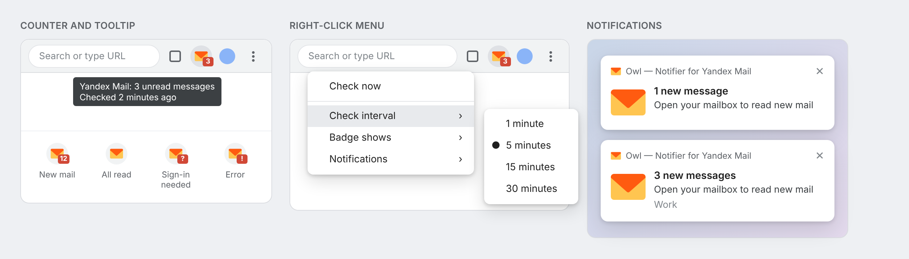

# Checker for Yandex Mail

[Русский](README.md) · **English**

[](https://chromewebstore.google.com/detail/gkpnpejbpnldkkeoeapjdilknlmojoon)
[](https://addons.mozilla.org/firefox/addon/yandex_mail_checker/)
[](https://microsoftedge.microsoft.com/addons/detail/pncdgkochfhddiclomicdbbhfgoeamcm)
[](https://github.com/Ogurtsov-D/Yandex_Mail_Checker/actions/workflows/ci.yml)
[](LICENSE)

**A browser extension that shows the number of unread Yandex Mail messages on the toolbar and notifies you about new mail.**

No need to keep your mailbox open: the extension checks your mail, shows the unread count on its icon and tells you about new messages.

> **Unofficial extension.** Not affiliated with or endorsed by Yandex — [details](#relationship-with-yandex).



<sub>Interface mockup: menus and notifications look slightly different depending on your browser and OS.</sub>

## Features

- 🔢 **Unread counter** on the toolbar icon: all folders except Spam, the same as Yandex Mail's own counter, or new messages only
- 📬 **New mail notifications**; clicking one opens your mailbox
- 🖱️ **Clicking the icon** switches to your already open mailbox instead of opening new tabs; if mail isn't open, it opens it in a tab or a separate window, as you choose
- ⚡ **Instant refresh**: read a message and the counter updates within seconds
- 🔕 **Sound and quiet hours**: make notifications silent (in Chrome) or turn them off at night
- ⏱️ **Check interval** of 1, 5, 15 or 30 minutes; mail is not checked while you are away from the computer
- ⌨️ **Keyboard shortcut** Alt+Shift+Y opens your mail
- 🎨 **Choice of icon**: classic, minimal, blue, green or purple, plus your own counter color
- ⚠️ **Clear errors**: "sign-in required", "no connection", "Yandex did not respond" — with hints on what to do
- 🌐 **Interface in 19 languages** — English, Russian, Ukrainian, Belarusian, Kazakh, Uzbek, Azerbaijani, Armenian, Georgian, Turkish, German, French, Romanian, Latvian, Estonian, Finnish, Hebrew and Chinese (Simplified and Traditional); chosen by your browser language. Found a translation mistake? [Let us know](https://github.com/Ogurtsov-D/Yandex_Mail_Checker/issues/new/choose)
- 🔒 **No third-party servers**: your data never leaves the browser

## Installation

<p>
  <a href="https://chromewebstore.google.com/detail/gkpnpejbpnldkkeoeapjdilknlmojoon"></a>
  <a href="https://addons.mozilla.org/firefox/addon/yandex_mail_checker/"></a>
  <a href="https://microsoftedge.microsoft.com/addons/detail/pncdgkochfhddiclomicdbbhfgoeamcm"></a>
</p>

| Browser | Where to get it | Version |
|---------|-----------------|---------|
| Chrome, Yandex Browser, Opera, Brave, Vivaldi | [Chrome Web Store](https://chromewebstore.google.com/detail/gkpnpejbpnldkkeoeapjdilknlmojoon) | 121 or later |
| Microsoft Edge | [Edge Add-ons](https://microsoftedge.microsoft.com/addons/detail/pncdgkochfhddiclomicdbbhfgoeamcm) | 121 or later |
| Firefox | [Firefox Add-ons](https://addons.mozilla.org/firefox/addon/yandex_mail_checker/) | 142 or later, except Android |

After installing, pin the icon to the toolbar (puzzle icon → 📌) and sign in to [Yandex Mail](https://mail.yandex.ru) in the same browser if you haven't yet. The extension from a store updates automatically.

By default the extension works with `mail.yandex.ru`; mail in other countries and Yandex 360 can be chosen in the settings — see ["Mail address"](#mail-address). Notifications work on Windows, macOS and Linux.

<sub>Without a store: archives for Chrome and Firefox are on the [releases page](https://github.com/Ogurtsov-D/Yandex_Mail_Checker/releases/latest); such an installation does not update by itself.</sub>

## How to use

| Action | Result |
|--------|--------|
| **Click** the icon | Opens your mail, or switches to the mail tab if it is already open |
| **Right-click** the icon | Menu: "Check now", check interval, what the badge shows, notifications, sound and quiet hours |
| **Alt+Shift+Y** | Same as clicking the icon. To change the shortcut: in Chrome — `chrome://extensions/shortcuts`, in Firefox — `about:addons` → ⚙ → "Manage Extension Shortcuts" |
| **Hover** over the icon | Tooltip: how many messages and when the last check was |
| **Click a notification** | Opens your mailbox (or switches to it if it is already open) |

### What the badge means

| Badge | Meaning |
|-------|---------|
| **3** | 3 unread messages (more than 99 shows **99+**) |
| *(empty)* | No unread mail |
| **?** | You need to sign in to Yandex Mail |
| **!** | Something went wrong — hover over the icon to see what |
| **↻** | A manual check is in progress |

The tooltip looks like this:

```
Yandex Mail: 3 unread messages, 1 new
Checked at 02:32 PM
```

"New" means messages that arrived after your last visit to the mailbox. Once you open your mail, this part of the tooltip disappears.

On errors it shows both the reason and the last successful result:

```
Yandex Mail: No connection
Last successful check at 02:20 PM: 3 unread messages
```

### Notifications

You get a notification when Yandex reports new messages; it shows how many new messages arrived, in any folder except Spam. Messages that were already unread when you installed the extension are not reported. Once you open your mail, the notification disappears by itself. Clicking a notification opens your mailbox; if a mail tab is already open, the extension switches to it.

Notifications don't show the sender or subject. They are only available from the mail page, and Yandex treats loading it as a visit to the mailbox: the new mail count would be reset for you in other browsers and on your phone too.

Right-click the icon → "Notifications":

- **"Show new mail notifications"** — turn notifications off completely;
- **"Sound"** — silent notifications (Chrome and Chromium-based browsers only; in Firefox the sound is controlled by your system settings);
- **"Quiet hours"** — no notifications at night, from 23:00 to 08:00 by default. You can change the time in the extension settings: right-click the icon → "Options" in Chrome, "All settings…" in Firefox. Messages that arrive during quiet hours are still shown on the counter.

### What the badge shows

Right-click the icon → "Badge shows": **"All unread messages"** (default) or **"New messages only"** — messages received since your last visit to the mailbox. In the second mode the badge clears as soon as you open your mail, even if some messages stay unread.

### Mail address

By default the extension works with `mail.yandex.ru`. If your mail is at `mail.yandex.com`, `mail.yandex.by`, `mail.yandex.kz`, `mail.yandex.com.tr` or in Yandex 360 (`mail.360.yandex.ru`, including mail on your own domain), choose the address in the extension settings (right-click the icon → "Options" in Chrome, "All settings…" in Firefox). The browser will ask for permission to access it.

### Several accounts

If you are signed in to several Yandex accounts, the extension counts mail in all of them:

- the badge shows the total, and the tooltip has a line for each account:
  ```
  Yandex Mail: 80 unread messages, 1 new
  ivan@yandex.ru: 75 unread messages, 1 new
  work@yandex.ru: 5 unread messages
  Checked at 02:32 PM
  ```
- right-clicking the icon lists the accounts with their message counts; click an account to open its mailbox. The other menu items move to the "Settings" submenu;
- a notification is labelled with the account the messages arrived in, and clicking it opens that account;
- accounts are labelled with their main email address; on the settings page you can give them your own names and uncheck an account to leave it out of the badge and notifications.

Clicking the icon does not pick an account: it switches to an open mail tab or, if there is none, opens mail in the account selected in Yandex. With one account everything works as before.

### Settings page

Right-click the icon → "Options" in Chrome, "All settings…" in Firefox. It has everything from the menu, plus:

- **mail address** — see above;
- **where to open mail** if it isn't open yet: in a tab or in a separate window without the address bar;
- **icon style and counter color** — background and digits, preset or custom;
- **quiet hours**, **pause while you are away**, **account names**.

### While you are away

After 5 minutes of inactivity or when the screen is locked, scheduled checks pause; when you come back, mail is checked right away. You can turn the pause off in the extension settings.

## Troubleshooting

<details>
<summary><b>The badge shows "?" although I am signed in</b></summary>

The extension works with mail in the same browser profile, at the address chosen in the settings (`mail.yandex.ru` by default). Open your mailbox: if Yandex asks you to sign in, do so, then right-click the icon → "Check now". If your mail is at a different address, choose it in the settings.

</details>

<details>
<summary><b>The badge shows "!" and "Could not read the mail page"</b></summary>

Open your mailbox. If Yandex shows a CAPTCHA, solve it. If the mailbox opens normally but the error persists, Yandex has probably changed something: please [report a bug](https://github.com/Ogurtsov-D/Yandex_Mail_Checker/issues/new/choose).

</details>

<details>
<summary><b>The badge shows "!" and "No connection" / "Yandex did not respond in time"</b></summary>

A network problem or an issue on Yandex's side. The extension retries twice after 30 seconds and then continues on its regular schedule. You don't need to do anything.

</details>

<details>
<summary><b>Notifications don't appear</b></summary>

Check, in order:

1. Right-click the icon → "Notifications": "Show new mail notifications" is checked, and quiet hours are off or not in effect right now.
2. Your operating system allows notifications from the browser: Windows — Settings → System → Notifications; macOS — System Settings → Notifications.
3. Do Not Disturb / Focus mode is off.

</details>

## Limitations

- Mail is checked at one address — the one chosen in the settings.
- Notifications don't show the sender or subject — only the number of new messages.
- The extension gets the counter from Yandex the same way the mail page does. If Yandex changes that, the extension falls back to counting via the lite version — the counter then covers the Inbox only.

## How it works

On every check the extension requests the mail counters (`https://mail.yandex.ru/api/v2/bar/counters`) with your usual Yandex cookies. These are two numbers: how many messages are unread (in all folders except Spam) and how many arrived since your last visit to the mailbox. The first number is shown on the icon. When the second one grows, you get a notification. Yandex does not treat this request as a visit to the mailbox, so it doesn't reset the new mail count in your mail. If you are signed in to several accounts, Yandex returns the counters for all of them in one response.

If the counters are unavailable, the extension falls back to the simplified Inbox page (`https://mail.yandex.ru/lite/inbox`): it counts unread messages and reports new ones with the sender and subject.

Checks run on schedule, when you click "Check now", and a few seconds after you act in the mail tab — but no more often than once every 15 seconds. The time of scheduled checks varies slightly (up to ±12.5% of the interval), so requests don't follow a strict timer.

## Privacy

The extension contacts only Yandex Mail at the chosen address (`mail.yandex.ru` by default) and sends nothing to the author or any third party. Message counts and settings are stored in your browser. Details, including why each permission is needed, are in the [privacy policy](PRIVACY.en.md).

## Feedback

Bug reports and suggestions are welcome in [Issues](https://github.com/Ogurtsov-D/Yandex_Mail_Checker/issues/new/choose), in English or Russian. Report vulnerabilities only [privately](https://github.com/Ogurtsov-D/Yandex_Mail_Checker/security/advisories/new). Version history is in [CHANGELOG.md](CHANGELOG.md) (in Russian).

## Relationship with Yandex

This extension is an independent open-source project. It is not affiliated with or endorsed by Yandex. "Yandex" and "Yandex Mail" are trademarks of their owner and are used only to indicate which service the extension works with.

The extension only reads the mail counters and the Inbox page on behalf of a user who is already signed in: it does not bypass CAPTCHA or authentication, does not perform any actions in the mailbox and does not modify Yandex pages. Scheduled checks run no more than once a minute, checks after actions in the mail tab no more than once every 15 seconds.

If you represent Yandex and have questions about this project, please write in [Issues](https://github.com/Ogurtsov-D/Yandex_Mail_Checker/issues) or, if the matter is not for public discussion, send a [private message](https://github.com/Ogurtsov-D/Yandex_Mail_Checker/security/advisories/new). We will discuss changes to the project or its removal.

## License

© 2026 [Ogurtsov-D](https://github.com/Ogurtsov-D). Distributed under the [GNU GPL v3](LICENSE): you may use, modify and redistribute it under the same terms. Provided "as is", without any warranty.
