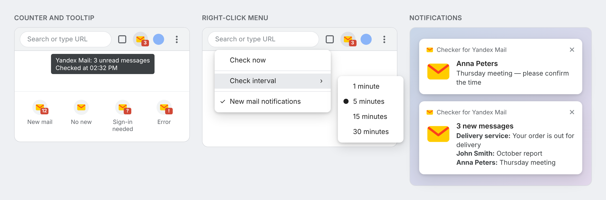

# Checker for Yandex Mail

[Русский](README.md) · **English**

[](https://github.com/Ogurtsov-D/Yandex_Mail_Checker/releases/latest)
[](https://github.com/Ogurtsov-D/Yandex_Mail_Checker/actions/workflows/ci.yml)


[](LICENSE)

**A browser extension that shows the number of unread Yandex Mail messages on the toolbar and notifies you about new mail.**

No need to keep your mailbox open: the extension checks your Inbox, shows the unread count on its icon and tells you about new messages with the sender and subject.

> **Unofficial extension.** Not affiliated with or endorsed by Yandex — [details](#relationship-with-yandex).



<sub>Interface mockup: names and subjects are made up; menus and notifications look slightly different depending on your browser and OS.</sub>

## Features

- 🔢 **Unread counter** on the toolbar icon for your Inbox
- 📬 **New mail notifications** with sender and subject; clicking one opens that message
- 🖱️ **Clicking the icon** switches to an already open mail tab instead of opening a new one
- ⚡ **Instant refresh**: read a message and the counter updates within seconds
- ⏱️ **Check interval** of 1, 5, 15 or 30 minutes
- ⚠️ **Clear errors**: "sign-in required", "no connection", "Yandex did not respond" — with hints on what to do
- 🌐 **English and Russian interface**, chosen by your browser language
- 🔒 **No third-party servers**: your data never leaves the browser

## Installation

The extension is not yet listed in browser stores (Chrome Web Store and addons.mozilla.org are planned), so you install it from a release file. It takes about a minute.

### Chrome, Yandex Browser, Edge, Brave, Opera, Vivaldi

1. Download `yandex-mail-checker-…-chrome.zip` from the [latest release](https://github.com/Ogurtsov-D/Yandex_Mail_Checker/releases/latest).
2. Unzip it into a permanent folder, e.g. `Documents/yandex-mail-checker`. **Do not delete it** — the browser loads the extension from that folder.
3. Open the extensions page: `chrome://extensions` (`browser://extensions` in Yandex Browser, `edge://extensions` in Edge).
4. Turn on **Developer mode** (a toggle in the top right or bottom left corner).
5. Click **Load unpacked** and select the unzipped folder.
6. Pin the icon to the toolbar (puzzle icon → 📌) and sign in to [Yandex Mail](https://mail.yandex.ru) if you haven't yet.

**Updating:** download the new archive, unzip it into the same folder replacing the files, and click ↻ on the extension card. Your settings are kept.

### Firefox

1. Download `yandex-mail-checker-…-firefox.xpi` from the [latest release](https://github.com/Ogurtsov-D/Yandex_Mail_Checker/releases/latest).
2. Open `about:addons`, click ⚙ → **Install Add-on From File…** and choose the downloaded file. You can also drag the file into a Firefox window.
3. Confirm the installation and sign in to [Yandex Mail](https://mail.yandex.ru) if you haven't yet.

The `.xpi` file is signed by Mozilla: the extension stays installed and **updates automatically**.

### Requirements

| Browser | Version |
|---------|---------|
| Chrome and Chromium-based browsers | 121 or later |
| Firefox | 140 or later (Android is not supported) |

You need to be signed in to Yandex Mail at `mail.yandex.ru` in the same browser. Notifications work on Windows, macOS and Linux.

## How to use

| Action | Result |
|--------|--------|
| **Click** the icon | Opens your mail, or switches to the mail tab if it is already open |
| **Right-click** the icon | Menu: "Check now", check interval, notifications on/off |
| **Hover** over the icon | Tooltip: how many messages and when the last check was |
| **Click a notification** | Opens that message (or your Inbox if there are several) |

### What the badge means

| Badge | Meaning |
|-------|---------|
| **3** | 3 unread messages (more than 99 shows **99+**) |
| *(empty)* | No new mail |
| **?** | You need to sign in to Yandex Mail |
| **!** | Something went wrong — hover over the icon to see what |
| **↻** | A manual check is in progress |

The tooltip looks like this:

```
Yandex Mail: 3 unread messages
Checked at 02:32 PM
```

On errors it shows both the reason and the last successful result:

```
Yandex Mail: No connection
Last successful check at 02:20 PM: 3 unread messages
```

### Notifications

You get a notification when a message the extension has not reported yet appears in your Inbox. Messages that were already unread when you installed the extension are not reported. If a mail tab is open, the message opens there; a tab where you are writing an email is never touched.

To turn notifications off: right-click the icon → uncheck "New mail notifications".

## Troubleshooting

<details>
<summary><b>The badge shows "?" although I am signed in</b></summary>

The extension works with `mail.yandex.ru` in the same browser profile. Open https://mail.yandex.ru/lite/inbox: if Yandex asks you to sign in, do so, then right-click the icon → "Check now". Mail on `mail.yandex.com`, `.by`, `.kz` and `.com.tr` is not supported yet.

</details>

<details>
<summary><b>The badge shows "!" and "Could not read the mail page"</b></summary>

Open https://mail.yandex.ru/lite/inbox. If Yandex shows a CAPTCHA, solve it. If the page opens normally but the error persists, Yandex has probably changed the page layout: please [report a bug](https://github.com/Ogurtsov-D/Yandex_Mail_Checker/issues/new/choose).

</details>

<details>
<summary><b>The badge shows "!" and "No connection" / "Yandex did not respond in time"</b></summary>

A network problem or an issue on Yandex's side. The extension retries twice after 30 seconds and then continues on its regular schedule. You don't need to do anything.

</details>

<details>
<summary><b>Notifications don't appear</b></summary>

Check, in order:

1. Right-click the icon → "New mail notifications" is checked.
2. Your operating system allows notifications from the browser: Windows — Settings → System → Notifications; macOS — System Settings → Notifications.
3. Do Not Disturb / Focus mode is off.

</details>

<details>
<summary><b>Clicking a notification opens the wrong message</b></summary>

Please [report a bug](https://github.com/Ogurtsov-D/Yandex_Mail_Checker/issues/new/choose) and include the address from the browser's address bar that you get when you open the message in your mailbox yourself (you can mask the message number with asterisks).

</details>

<details>
<summary><b>How to see the extension log</b></summary>

Chrome: `chrome://extensions` → extension card → **service worker** link → **Console** tab.
Firefox: `about:debugging#/runtime/this-firefox` → **Inspect** next to the extension → **Console**.

Remove any personal data before attaching the log to a bug report.

</details>

## Limitations

- Only the **Inbox** of one account is checked — the one you are signed in to in the browser.
- Only **`mail.yandex.ru`** is supported.
- Sender and subject in notifications come from the first page of the message list.
- The extension reads the simplified (lite) version of Yandex Mail. If Yandex changes or retires it, the extension shows "!" with a hint until an update is released.

## How it works

The extension requests the simplified Inbox page (`https://mail.yandex.ru/lite/inbox`) with your usual Yandex cookies — just as if you opened that page yourself. From the page it reads the number of unread messages and the ID, sender and subject of each unread message. The IDs are compared with the ones it already knows, so you are notified only about new mail.

Checks run on schedule, when you click "Check now", and a few seconds after you act in the mail tab — but no more often than once every 15 seconds.

## Privacy

The extension contacts only `mail.yandex.ru` and sends nothing to the author or any third party. The unread count, recent message IDs and settings are stored in your browser. Details are in the [privacy policy](PRIVACY.md) (in Russian).

| Permission | Why it is needed |
|------------|------------------|
| `https://mail.yandex.ru/*` | Read the message list; find an open mail tab and notice changes in it |
| `storage` | Keep settings and the result of the last check |
| `alarms` | Check mail on schedule |
| `notifications` | Show new mail notifications |
| `contextMenus` | Right-click menu on the icon |

## Contributing

Bug reports and suggestions are welcome in [Issues](https://github.com/Ogurtsov-D/Yandex_Mail_Checker/issues/new/choose) — in English or Russian. Report vulnerabilities only [privately](https://github.com/Ogurtsov-D/Yandex_Mail_Checker/security/advisories/new); see [SECURITY.md](SECURITY.md). How the code is organized, how to run tests and how to release a new version is described in [CONTRIBUTING.md](CONTRIBUTING.md). Version history is in [CHANGELOG.md](CHANGELOG.md). These documents are in Russian.

## Acknowledgements

- Yandex — for the lightweight version of its mail service that this extension is built on.
- The authors of the tools that development relies on: [ESLint](https://eslint.org/), [Prettier](https://prettier.io/) and Mozilla's [web-ext](https://github.com/mozilla/web-ext).
- Everyone who reports bugs and suggests improvements — [contributors](https://github.com/Ogurtsov-D/Yandex_Mail_Checker/graphs/contributors).

## Relationship with Yandex

This extension is an independent open-source project. It is not affiliated with or endorsed by Yandex. "Yandex" and "Yandex Mail" are trademarks of their owner and are used only to indicate which service the extension works with.

The extension only reads the Inbox page on behalf of a user who is already signed in: it does not bypass CAPTCHA or authentication, does not perform any actions in the mailbox and does not modify Yandex pages. Scheduled checks run no more than once a minute, checks after actions in the mail tab no more than once every 15 seconds.

If you represent Yandex and have questions about this project, please write in [Issues](https://github.com/Ogurtsov-D/Yandex_Mail_Checker/issues) or, if the matter is not for public discussion, send a [private message](https://github.com/Ogurtsov-D/Yandex_Mail_Checker/security/advisories/new). We will discuss changes to the project or its removal.

## License

© 2026 [Ogurtsov-D](https://github.com/Ogurtsov-D). Distributed under the [GNU GPL v3](LICENSE): you may use, modify and redistribute it under the same terms. Provided "as is", without any warranty.
