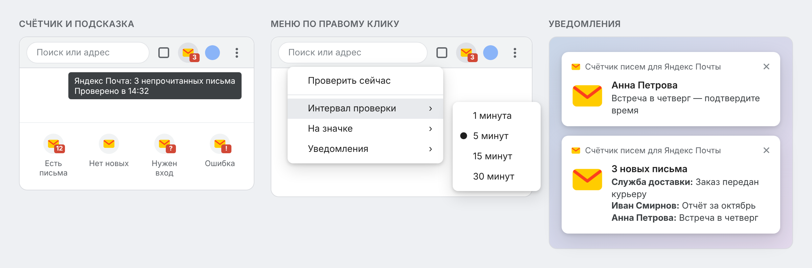

# Счётчик писем для Яндекс Почты

**Русский** · [English](README.en.md)

[](https://github.com/Ogurtsov-D/Yandex_Mail_Checker/releases/latest)
[](https://github.com/Ogurtsov-D/Yandex_Mail_Checker/actions/workflows/ci.yml)


[](LICENSE)

**Расширение для браузера: число непрочитанных писем Яндекс Почты на панели инструментов и уведомления о новых письмах.**

Не нужно держать почту открытой — расширение само проверяет почту, показывает счётчик на иконке и сообщает о новых письмах с отправителем и темой.

> **Неофициальное расширение.** Не связано с компанией Яндекс и не одобрено ею — [подробнее](#отношения-с-яндексом).



<sub>Макет интерфейса: имена и темы писем вымышлены, внешний вид меню и уведомлений зависит от браузера и ОС.</sub>

## Возможности

- 🔢 **Счётчик на иконке** — сколько непрочитанных писем во всех папках, кроме «Спама», как в счётчике самой Яндекс Почты, или только новых
- 📬 **Уведомления о новых письмах** с отправителем и темой; клик открывает само письмо
- 🖱️ **Клик по иконке** переключает на уже открытую вкладку почты, а не плодит новые
- ⚡ **Мгновенное обновление**: прочитали письмо — счётчик обновится через несколько секунд
- 🔕 **Звук и тихие часы**: уведомления можно сделать беззвучными (в Chrome) или отключать на ночь
- ⏱️ **Интервал проверки** 1, 5, 15 или 30 минут; пока вы не за компьютером, почта не проверяется
- ⌨️ **Горячая клавиша** Alt+Shift+Y открывает почту
- ⚠️ **Понятные ошибки**: «нужен вход», «нет сети», «Яндекс не отвечает» — с подсказкой, что делать
- 🌐 **Русский и английский интерфейс** — выбирается по языку браузера
- 🔒 **Без сторонних серверов**: данные не покидают браузер

## Установка

Расширение пока не опубликовано в каталогах браузеров (Chrome Web Store и каталог addons.mozilla.org — в планах), поэтому устанавливается из файла со страницы релизов. Это занимает около минуты.

### Chrome, Яндекс Браузер, Edge, Brave, Opera, Vivaldi

1. Скачайте `yandex-mail-checker-…-chrome.zip` со страницы [последнего релиза](https://github.com/Ogurtsov-D/Yandex_Mail_Checker/releases/latest).
2. Распакуйте архив в постоянную папку, например `Документы/yandex-mail-checker`. **Не удаляйте её** — браузер загружает расширение из этой папки.
3. Откройте страницу расширений: `chrome://extensions` (в Яндекс Браузере — `browser://extensions`, в Edge — `edge://extensions`).
4. Включите **«Режим разработчика»** (переключатель справа вверху или слева внизу).
5. Нажмите **«Загрузить распакованное расширение»** и выберите распакованную папку.
6. Закрепите иконку на панели (значок пазла → 📌) и войдите в [Яндекс Почту](https://mail.yandex.ru), если ещё не вошли.

**Обновление:** скачайте новый архив, распакуйте его в ту же папку с заменой файлов и нажмите ↻ на карточке расширения. Настройки сохранятся.

### Firefox

1. Скачайте `yandex-mail-checker-…-firefox.xpi` со страницы [последнего релиза](https://github.com/Ogurtsov-D/Yandex_Mail_Checker/releases/latest).
2. Откройте `about:addons`, нажмите ⚙ → **«Установить дополнение из файла…»** и выберите скачанный файл. Можно и просто перетащить файл в окно Firefox.
3. Подтвердите установку и войдите в [Яндекс Почту](https://mail.yandex.ru), если ещё не вошли.

Файл `.xpi` подписан Mozilla: расширение устанавливается навсегда и **обновляется автоматически**.

### Требования

| Браузер | Версия |
|---------|--------|
| Chrome и браузеры на его основе | 121 и новее |
| Firefox | 142 и новее (для Android не поддерживается) |

Нужен вход в Яндекс Почту на `mail.yandex.ru` в этом же браузере. Уведомления работают в Windows, macOS и Linux.

## Как пользоваться

| Действие | Что произойдёт |
|----------|----------------|
| **Клик** по иконке | Откроется почта: если вкладка с ней уже есть — переключение на неё |
| **Правый клик** по иконке | Меню: «Проверить сейчас», интервал проверки, что показывать на значке, уведомления, звук и тихие часы |
| **Alt+Shift+Y** | То же, что клик по иконке. Сочетание можно изменить: в Chrome — `chrome://extensions/shortcuts`, в Firefox — `about:addons` → ⚙ → «Управление горячими клавишами расширений» |
| **Наведение** на иконку | Подсказка: сколько писем и когда была проверка |
| **Клик по уведомлению** | Откроется это письмо (если писем несколько — почта) |

### Что значит бейдж на иконке

| Бейдж | Значение |
|-------|----------|
| **3** | 3 непрочитанных письма (больше 99 — **99+**) |
| *(пусто)* | Новых писем нет |
| **?** | Нужно войти в Яндекс Почту |
| **!** | Ошибка — что именно, видно в подсказке при наведении |
| **↻** | Идёт проверка, запущенная вручную |

Подсказка выглядит так:

```
Яндекс Почта: 3 непрочитанных письма, из них 1 новое
Проверено в 14:32
```

«Новые» — письма, пришедшие после того, как вы последний раз заходили в почту. Когда вы откроете почту, эта часть подсказки исчезнет.

При ошибке в подсказке видна и причина, и последний успешный результат:

```
Яндекс Почта: Нет подключения
Последняя успешная проверка в 14:20: 3 непрочитанных письма
```

### Уведомления

Уведомление приходит, когда Яндекс сообщает о новых письмах. Отправитель и тема берутся из «Входящих»; если письмо попало в другую папку, уведомление покажет только число новых писем. О письмах, которые уже были непрочитанными при установке, расширение не сообщает. Когда вы откроете почту, уведомление о новых письмах исчезнет само. Если вкладка почты открыта, письмо откроется в ней; вкладку, где вы пишете письмо, расширение не трогает.

Правый клик по иконке → «Уведомления»:

- **«Показывать уведомления о новых письмах»** — выключить уведомления совсем;
- **«Звук»** — уведомления без звука (только в Chrome и браузерах на его основе; в Firefox звук задаётся настройками системы);
- **«Тихие часы»** — не показывать уведомления ночью, по умолчанию с 23:00 до 08:00. Время меняется в настройках расширения: правый клик по иконке → «Параметры» в Chrome, «Настройки…» в Firefox. Письма, пришедшие в тихие часы, видны на счётчике.

### Что показывать на значке

Правый клик по иконке → «На значке»: **«Все непрочитанные»** (по умолчанию) или **«Только новые»** — письма, пришедшие после вашего последнего захода в почту. Во втором режиме значок пустеет, как только вы открыли почту, даже если какие-то письма остались непрочитанными.

### Пока вы не за компьютером

Если 5 минут нет действий или экран заблокирован, плановые проверки приостанавливаются, а когда вы вернётесь, почта проверится сразу. Отключить паузу можно в настройках расширения.

## Решение проблем

<details>
<summary><b>Бейдж «?», хотя я вошёл в почту</b></summary>

Расширение работает с `mail.yandex.ru` в том же профиле браузера. Откройте https://mail.yandex.ru/lite/inbox: если Яндекс просит войти — войдите, затем правый клик по иконке → «Проверить сейчас». Почта на `mail.yandex.com`, `.by`, `.kz` и `.com.tr` пока не поддерживается.

</details>

<details>
<summary><b>Бейдж «!» и «Не удалось прочитать страницу почты»</b></summary>

Откройте https://mail.yandex.ru/lite/inbox. Если Яндекс показывает капчу — пройдите её. Если страница открывается нормально, а ошибка остаётся, вероятно, Яндекс изменил вёрстку: [сообщите об ошибке](https://github.com/Ogurtsov-D/Yandex_Mail_Checker/issues/new/choose).

</details>

<details>
<summary><b>Бейдж «!» и «Нет подключения» / «Яндекс не ответил вовремя»</b></summary>

Проблема с сетью или на стороне Яндекса. Расширение дважды повторит проверку через 30 секунд, а затем будет проверять по обычному расписанию. Ничего делать не нужно.

</details>

<details>
<summary><b>Не приходят уведомления</b></summary>

Проверьте по порядку:

1. Правый клик по иконке → «Уведомления»: стоит галочка «Показывать уведомления о новых письмах», а тихие часы не включены или сейчас не действуют.
2. Уведомления разрешены браузеру в системе: Windows — «Параметры → Система → Уведомления», macOS — «Системные настройки → Уведомления».
3. Не включён режим «Не беспокоить» / «Фокусировка».

</details>

<details>
<summary><b>Клик по уведомлению открывает не то письмо</b></summary>

[Сообщите об ошибке](https://github.com/Ogurtsov-D/Yandex_Mail_Checker/issues/new/choose) и приложите адрес из строки браузера, который получается, когда вы открываете письмо в почте вручную (номер письма можно заменить звёздочками).

</details>

<details>
<summary><b>Как посмотреть журнал работы расширения</b></summary>

Chrome: `chrome://extensions` → карточка расширения → ссылка **service worker** → вкладка **Console**.
Firefox: `about:debugging#/runtime/this-firefox` → **Исследовать** у расширения → **Консоль**.

Перед тем как прикладывать журнал к сообщению об ошибке, удалите из него личные данные.

</details>

## Ограничения

- Проверяется один аккаунт — тот, в который выполнен вход в браузере.
- Поддерживается только **`mail.yandex.ru`**.
- Отправитель и тема в уведомлениях берутся с первой страницы «Входящих» упрощённой (lite) версии почты. Если Яндекс изменит или закроет её, уведомления придут без отправителя и темы.
- Счётчик расширение получает от Яндекса так же, как его получает страница почты. Если Яндекс изменит этот способ, расширение перейдёт на подсчёт по lite-версии — тогда счётчик покажет только «Входящие».

## Как это работает

При каждой проверке расширение с вашими обычными cookie Яндекса запрашивает счётчики почты (`https://mail.yandex.ru/api/v2/bar/counters`) — два числа: сколько писем не прочитано (во всех папках, кроме «Спама») и сколько пришло после вашего последнего захода в почту. Первое число показывается на иконке. Если второе выросло, расширение открывает упрощённую версию «Входящих» (`https://mail.yandex.ru/lite/inbox`) — так же, как если бы вы открыли её сами — и берёт оттуда номер, отправителя и тему новых писем. Номера сравниваются с уже известными, поэтому об одном письме уведомление приходит один раз.

Если счётчики недоступны, расширение считает непрочитанные письма по упрощённой версии «Входящих».

Проверка происходит по расписанию, по команде «Проверить сейчас» и через несколько секунд после действий во вкладке почты — не чаще раза в 15 секунд. Время плановых проверок немного меняется от раза к разу (до ±12,5% интервала), чтобы запросы не шли строго по таймеру.

## Конфиденциальность

Расширение обращается только к `mail.yandex.ru` и ничего не отправляет ни автору, ни третьим лицам. Число писем, номера последних писем и настройки хранятся в самом браузере. Подробности — в [политике конфиденциальности](PRIVACY.md).

| Разрешение | Зачем оно нужно |
|------------|-----------------|
| `https://mail.yandex.ru/*` | Читать счётчики и список писем; находить уже открытую вкладку почты и замечать в ней изменения |
| `storage` | Хранить настройки и результат последней проверки |
| `alarms` | Проверять почту по расписанию |
| `notifications` | Показывать уведомления о новых письмах |
| `contextMenus` | Меню по правому клику на иконке |
| `idle` | Не проверять почту, пока вы не за компьютером: расширение узнаёт только, работает ли компьютер, простаивает или заблокирован |

## Участие в разработке

Сообщения об ошибках и предложения — в [Issues](https://github.com/Ogurtsov-D/Yandex_Mail_Checker/issues/new/choose). Уязвимости — только [закрытым сообщением](https://github.com/Ogurtsov-D/Yandex_Mail_Checker/security/advisories/new), подробнее — в [SECURITY.md](SECURITY.md). Как устроен код, как запустить тесты и выпустить новую версию — в [CONTRIBUTING.md](CONTRIBUTING.md). История версий — в [CHANGELOG.md](CHANGELOG.md).

## Благодарности

- Яндексу — за лёгкую версию почты, на которой построено расширение.
- Авторам инструментов, на которых держится разработка: [ESLint](https://eslint.org/), [Prettier](https://prettier.io/) и [web-ext](https://github.com/mozilla/web-ext) от Mozilla.
- Всем, кто сообщает об ошибках и предлагает улучшения, — [участники проекта](https://github.com/Ogurtsov-D/Yandex_Mail_Checker/graphs/contributors).

## Отношения с Яндексом

Расширение — независимый проект с открытым исходным кодом. Оно не связано с компанией Яндекс и не одобрено ею. «Яндекс» и «Яндекс Почта» — товарные знаки их правообладателя; они упоминаются только чтобы указать, с каким сервисом работает расширение.

Расширение только читает счётчики почты и страницу «Входящих» от имени уже вошедшего пользователя: не обходит капчу и авторизацию, не выполняет действий в почте и не изменяет страницы Яндекса. Плановые проверки — не чаще раза в минуту, проверки после действий во вкладке почты — не чаще раза в 15 секунд.

Если вы представляете Яндекс и у вас есть вопросы к проекту, напишите в [Issues](https://github.com/Ogurtsov-D/Yandex_Mail_Checker/issues) или, если вопрос не для публичного обсуждения, [закрытым сообщением](https://github.com/Ogurtsov-D/Yandex_Mail_Checker/security/advisories/new). Мы обсудим доработку или удаление проекта.

## Лицензия

© 2026 [Ogurtsov-D](https://github.com/Ogurtsov-D). Распространяется по лицензии [GNU GPL v3](LICENSE): программу можно свободно использовать, изменять и распространять на тех же условиях. Предоставляется «как есть», без каких-либо гарантий.
