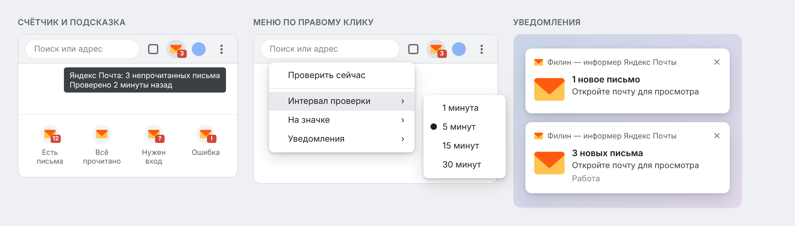

# Филин — информер Яндекс Почты

**Русский** · [English](README.en.md)

[](https://chromewebstore.google.com/detail/gkpnpejbpnldkkeoeapjdilknlmojoon)
[](https://addons.mozilla.org/firefox/addon/yandex_mail_checker/)
[](https://microsoftedge.microsoft.com/addons/detail/pncdgkochfhddiclomicdbbhfgoeamcm)
[](https://github.com/Ogurtsov-D/Yandex_Mail_Checker/actions/workflows/ci.yml)
[](LICENSE)

**Расширение для браузера: число непрочитанных писем Яндекс Почты на панели инструментов и уведомления о новых письмах.**

Не нужно держать почту открытой — расширение само проверяет почту, показывает счётчик на иконке и сообщает о новых письмах.

> **Неофициальное расширение.** Не связано с компанией Яндекс и не одобрено ею — [подробнее](#отношения-с-яндексом).



<sub>Макет интерфейса: внешний вид меню и уведомлений зависит от браузера и ОС.</sub>

## Возможности

- 🔢 **Счётчик на иконке** — сколько непрочитанных писем во всех папках, кроме «Спама», как в счётчике самой Яндекс Почты, или только новых
- 📬 **Уведомления о новых письмах**; клик по уведомлению открывает почту
- 🖱️ **Клик по иконке** переключает на уже открытую почту, а не плодит новые вкладки; если почта не открыта — открывает её во вкладке или в отдельном окне, как вы выберете
- ⚡ **Мгновенное обновление**: прочитали письмо — счётчик обновится через несколько секунд
- 🔕 **Звук и тихие часы**: уведомления можно сделать беззвучными (в Chrome) или отключать на ночь
- ⏱️ **Интервал проверки** 1, 5, 15 или 30 минут; пока вы не за компьютером, почта не проверяется
- ⌨️ **Горячая клавиша** Alt+Shift+Y открывает почту
- 🎨 **Вид значка на выбор**: классический, минималистичный, синий, зелёный или фиолетовый, и свой цвет счётчика
- ⚠️ **Понятные ошибки**: «нужен вход», «нет сети», «Яндекс не отвечает» — с подсказкой, что делать
- 🌐 **Интерфейс на 19 языках** — русском, английском, украинском, белорусском, казахском, узбекском, азербайджанском, армянском, грузинском, турецком, немецком, французском, румынском, латышском, эстонском, финском, иврите и китайском (упрощённом и традиционном); выбирается по языку браузера. Нашли ошибку в переводе — [напишите](https://github.com/Ogurtsov-D/Yandex_Mail_Checker/issues/new/choose)
- 🔒 **Без сторонних серверов**: данные не покидают браузер

## Установка

<p>
  <a href="https://chromewebstore.google.com/detail/gkpnpejbpnldkkeoeapjdilknlmojoon"></a>
  <a href="https://addons.mozilla.org/firefox/addon/yandex_mail_checker/"></a>
  <a href="https://microsoftedge.microsoft.com/addons/detail/pncdgkochfhddiclomicdbbhfgoeamcm"></a>
</p>

| Браузер | Откуда установить | Версия |
|---------|-------------------|--------|
| Chrome, Яндекс Браузер, Opera, Brave, Vivaldi | [Chrome Web Store](https://chromewebstore.google.com/detail/gkpnpejbpnldkkeoeapjdilknlmojoon) | 121 и новее |
| Microsoft Edge | [Edge Add-ons](https://microsoftedge.microsoft.com/addons/detail/pncdgkochfhddiclomicdbbhfgoeamcm) | 121 и новее |
| Firefox | [Каталог дополнений Firefox](https://addons.mozilla.org/firefox/addon/yandex_mail_checker/) | 142 и новее, кроме Android |

После установки откроется страница приветствия: закрепите значок на панели (значок пазла → 📌), выберите адрес почты, если она не на `mail.yandex.ru`, и войдите в [Яндекс Почту](https://mail.yandex.ru) в этом же браузере, если ещё не вошли. Расширение из магазина обновляется само.

По умолчанию расширение работает с `mail.yandex.ru`; почту в других странах и в Яндекс 360 можно выбрать в настройках — см. [«Адрес почты»](#адрес-почты). Уведомления работают в Windows, macOS и Linux.

<sub>Без магазина: архивы для Chrome и Firefox — на [странице релизов](https://github.com/Ogurtsov-D/Yandex_Mail_Checker/releases/latest); такая установка сама не обновляется.</sub>

## Как пользоваться

| Действие | Что произойдёт |
|----------|----------------|
| **Клик** по иконке | Откроется почта: если вкладка с ней уже есть — переключение на неё |
| **Правый клик** по иконке | Меню: «Проверить сейчас», интервал проверки, что показывать на значке, уведомления, звук и тихие часы |
| **Alt+Shift+Y** | То же, что клик по иконке. Сочетание можно изменить: в Chrome — `chrome://extensions/shortcuts`, в Firefox — `about:addons` → ⚙ → «Управление горячими клавишами расширений» |
| **Наведение** на иконку | Подсказка: сколько писем и когда была проверка |
| **Клик по уведомлению** | Откроется почта (если она уже открыта — переключение на неё) |

### Что значит бейдж на иконке

| Бейдж | Значение |
|-------|----------|
| **3** | 3 непрочитанных письма (больше 99 — **99+**) |
| *(пусто)* | Непрочитанных писем нет |
| **?** | Нужно войти в Яндекс Почту |
| **!** | Ошибка — что именно, видно в подсказке при наведении |
| **↻** | Идёт проверка, запущенная вручную |

Подсказка выглядит так:

```
Яндекс Почта: 3 непрочитанных письма, из них 1 новое
Проверено 2 минуты назад
```

«Новые» — письма, пришедшие после того, как вы последний раз заходили в почту. Когда вы откроете почту, эта часть подсказки исчезнет.

При ошибке в подсказке видна и причина, и последний успешный результат:

```
Яндекс Почта: Нет подключения
Последняя успешная проверка 12 минут назад: 3 непрочитанных письма
```

### Уведомления

Уведомление приходит, когда Яндекс сообщает о новых письмах, — в нём число новых писем, в любых папках, кроме «Спама». О письмах, которые уже были непрочитанными при установке, расширение не сообщает. Когда вы откроете почту, уведомление исчезнет само. Клик по уведомлению открывает почту; если вкладка почты уже открыта, расширение переключится на неё.

Отправителя и темы в уведомлении нет. Их можно узнать только со страницы почты, а Яндекс считает её загрузку заходом в почту: счётчик новых писем обнулялся бы и у вас в других браузерах и на телефоне.

Правый клик по иконке → «Уведомления»:

- **«Показывать уведомления о новых письмах»** — выключить уведомления совсем;
- **«Звук»** — уведомления без звука (только в Chrome и браузерах на его основе; в Firefox звук задаётся настройками системы);
- **«Тихие часы»** — не показывать уведомления ночью, по умолчанию с 23:00 до 08:00. Время меняется в настройках расширения: правый клик по иконке → «Параметры» в Chrome, «Все настройки…» в Firefox. Письма, пришедшие в тихие часы, видны на счётчике.

### Что показывать на значке

Правый клик по иконке → «На значке»: **«Все непрочитанные»** (по умолчанию) или **«Только новые»** — письма, пришедшие после вашего последнего захода в почту. Во втором режиме значок пустеет, как только вы открыли почту, даже если какие-то письма остались непрочитанными.

### Адрес почты

По умолчанию расширение работает с `mail.yandex.ru`. Если ваша почта на `mail.yandex.com`, `mail.yandex.by`, `mail.yandex.kz`, `mail.yandex.com.tr` или в Яндекс 360 (`mail.360.yandex.ru`, в том числе почта на своём домене), выберите адрес в настройках расширения (правый клик по иконке → «Параметры» в Chrome, «Все настройки…» в Firefox). Браузер спросит разрешение на доступ к этому адресу.

### Несколько аккаунтов

Если вы вошли в Яндексе в несколько аккаунтов, расширение считает письма во всех сразу:

- на значке — сумма по аккаунтам, в подсказке — строка на каждый:
  ```
  Яндекс Почта: 80 непрочитанных писем, из них 1 новое
  ivan@yandex.ru: 75 непрочитанных писем, из них 1 новое
  work@yandex.ru: 5 непрочитанных писем
  Проверено 2 минуты назад
  ```
- правый клик по иконке показывает аккаунты с числом писем; клик по аккаунту открывает его почту. Остальные пункты меню — в подменю «Настройки»;
- уведомление подписано аккаунтом, в который пришли письма, и по клику открывает этот аккаунт;
- аккаунты подписаны основным адресом почты; на странице настроек им можно дать свои имена и снять галочку, чтобы не учитывать аккаунт на значке и в уведомлениях.

Клик по иконке аккаунт не выбирает: он переключает на открытую вкладку почты, а если её нет — открывает почту в аккаунте, выбранном в Яндексе. С одним аккаунтом всё работает как раньше.

### Страница настроек

Правый клик по иконке → «Параметры» в Chrome, «Все настройки…» в Firefox. Вверху — состояние почты: результат последней проверки и кнопки «Проверить сейчас» и «Открыть почту». Дальше собраны все настройки из меню и ещё:

- **адрес почты** — см. выше;
- **где открывать почту**, если она ещё не открыта: во вкладке или в отдельном окне без адресной строки;
- **вид значка и цвет счётчика** — фон и цифры, готовые цвета или свой;
- **тихие часы**, **пауза, пока вы не за компьютером**, **имена аккаунтов**.

### Пока вы не за компьютером

Если 5 минут нет действий или экран заблокирован, плановые проверки приостанавливаются, а когда вы вернётесь, почта проверится сразу. Отключить паузу можно в настройках расширения.

## Решение проблем

<details>
<summary><b>Бейдж «?», хотя я вошёл в почту</b></summary>

Расширение работает с почтой в том же профиле браузера, на адресе, выбранном в настройках (по умолчанию `mail.yandex.ru`). Откройте почту: если Яндекс просит войти — войдите, затем правый клик по иконке → «Проверить сейчас». Если ваша почта на другом адресе, выберите его в настройках.

</details>

<details>
<summary><b>Бейдж «!» и «Не удалось прочитать страницу почты»</b></summary>

Откройте почту. Если Яндекс показывает капчу — пройдите её. Если почта открывается нормально, а ошибка остаётся, вероятно, Яндекс что-то изменил: [сообщите об ошибке](https://github.com/Ogurtsov-D/Yandex_Mail_Checker/issues/new/choose).

</details>

<details>
<summary><b>Бейдж «!» и «Нет подключения» / «Яндекс не ответил вовремя»</b></summary>

Проблема с сетью или на стороне Яндекса. Расширение дважды повторит проверку через 30 секунд, а затем будет проверять по обычному расписанию. Ничего делать не нужно.

</details>

<details>
<summary><b>Не приходят уведомления</b></summary>

Проверьте по порядку:

1. Правый клик по иконке → «Уведомления»: стоит галочка «Показывать уведомления о новых письмах», а тихие часы не включены или сейчас не действуют.
2. Уведомления разрешены браузеру в системе: Windows — «Параметры → Система → Уведомления», macOS — «Системные настройки → Уведомления».
3. Не включён режим «Не беспокоить» / «Фокусировка».

</details>

## Ограничения

- Проверяется почта на одном адресе — выбранном в настройках.
- В уведомлении нет отправителя и темы письма — только число новых писем.
- Счётчик расширение получает от Яндекса так же, как его получает страница почты. Если Яндекс изменит этот способ, расширение перейдёт на подсчёт по lite-версии — тогда счётчик покажет только «Входящие».

## Как это работает

При каждой проверке расширение с вашими обычными cookie Яндекса запрашивает счётчики почты (`https://mail.yandex.ru/api/v2/bar/counters`) — два числа: сколько писем не прочитано (во всех папках, кроме «Спама») и сколько пришло после вашего последнего захода в почту. Первое число показывается на иконке. Если второе выросло, приходит уведомление. Этот запрос Яндекс не считает заходом в почту, поэтому счётчик новых писем у вас в почте он не сбрасывает. Если вы вошли в несколько аккаунтов, Яндекс отдаёт счётчики по каждому из них в одном ответе.

Если счётчики недоступны, расширение работает по упрощённой версии «Входящих» (`https://mail.yandex.ru/lite/inbox`): считает непрочитанные письма и сообщает о новых с отправителем и темой.

Проверка происходит по расписанию, по команде «Проверить сейчас» и через несколько секунд после действий во вкладке почты — не чаще раза в 15 секунд. Время плановых проверок немного меняется от раза к разу (до ±12,5% интервала), чтобы запросы не шли строго по таймеру.

## Конфиденциальность

Расширение обращается только к почте Яндекса на выбранном адресе (по умолчанию `mail.yandex.ru`) и ничего не отправляет ни автору, ни третьим лицам. Число писем и настройки хранятся в самом браузере. Подробности и зачем нужно каждое разрешение — в [политике конфиденциальности](PRIVACY.md).

## Обратная связь

Ошибки и предложения — в [Issues](https://github.com/Ogurtsov-D/Yandex_Mail_Checker/issues/new/choose), уязвимости — только [закрытым сообщением](https://github.com/Ogurtsov-D/Yandex_Mail_Checker/security/advisories/new). История версий — в [CHANGELOG.md](CHANGELOG.md).

## Отношения с Яндексом

Расширение — независимый проект с открытым исходным кодом. Оно не связано с компанией Яндекс и не одобрено ею. «Яндекс» и «Яндекс Почта» — товарные знаки их правообладателя; они упоминаются только чтобы указать, с каким сервисом работает расширение.

Расширение только читает счётчики почты и страницу «Входящих» от имени уже вошедшего пользователя: не обходит капчу и авторизацию, не выполняет действий в почте и не изменяет страницы Яндекса. Плановые проверки — не чаще раза в минуту, проверки после действий во вкладке почты — не чаще раза в 15 секунд.

Если вы представляете Яндекс и у вас есть вопросы к проекту, напишите в [Issues](https://github.com/Ogurtsov-D/Yandex_Mail_Checker/issues) или, если вопрос не для публичного обсуждения, [закрытым сообщением](https://github.com/Ogurtsov-D/Yandex_Mail_Checker/security/advisories/new). Мы обсудим доработку или удаление проекта.

## Лицензия

© 2026 [Ogurtsov-D](https://github.com/Ogurtsov-D). Распространяется по лицензии [GNU GPL v3](LICENSE): программу можно свободно использовать, изменять и распространять на тех же условиях. Предоставляется «как есть», без каких-либо гарантий.
